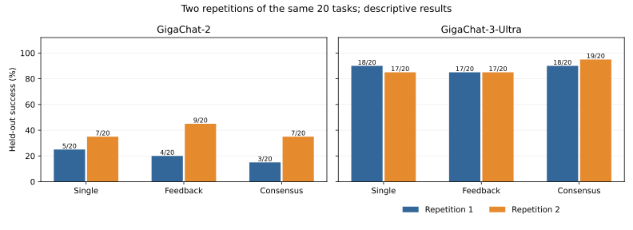

# When Is Multi-Agent Coordination Worth Its Cost?

An empirical comparison of LLM coordination workflows for Python code generation.

This repository studies a practical trade-off: whether additional model calls, feedback, and candidate selection produce enough correct solutions to justify their cost. The experiments compare GigaChat 2 Lite and GigaChat 3 Ultra on the same programming tasks using a single-agent baseline and two coordination workflows.

## Results

Benchmark v3 includes 20 predefined tasks, two models, three workflows, and two complete repetitions. Each task was evaluated against held-out tests. The table reports successes across the two repetitions; each condition uses the same 20 tasks twice.

| Model | Workflow | Run 1 | Run 2 | Combined | Tokens, incl. cached input |
| --- | --- | ---: | ---: | ---: | ---: |
| GigaChat 2 Lite | Single agent | 5/20 | 7/20 | 12/40 | 18,541 |
| GigaChat 2 Lite | Feedback graph | 4/20 | 9/20 | 13/40 | 151,777 |
| GigaChat 2 Lite | Parallel consensus | 3/20 | 7/20 | 10/40 | 131,039 |
| GigaChat 3 Ultra | Single agent | 18/20 | 17/20 | 35/40 | 17,915 |
| GigaChat 3 Ultra | Feedback graph | 17/20 | 17/20 | 34/40 | 92,668 |
| GigaChat 3 Ultra | Parallel consensus | 18/20 | 19/20 | 37/40 | 136,201 |

Across the two complete runs, the benchmark recorded **240 evaluations, 141 passes, 965 model calls, and 548,141 tokens** (input usage, cached input, and output combined).



The stronger model passed substantially more tasks in this suite. Coordination sometimes improved correctness relative to a single call, but its advantage changed between repetitions and was small compared with its token overhead. For example, Ultra's consensus workflow passed 37/40 evaluations versus 35/40 for the single-agent baseline, using roughly 7.6 times as many tokens overall.

These are descriptive results from a limited task suite, not evidence of a general or causal advantage.

## Experimental design

The v3 task set was fixed before model evaluation: four easy, eight medium, and eight hard tasks. It covers parsing, data structures, graph algorithms, dynamic programming, and stateful software-engineering problems. Each task has visible examples, separate development tests, held-out evaluation tests, and a validated reference solution.

The three measured workflows are:

- **Single agent:** one model-generated candidate, without coordination.
- **Feedback graph:** development-test feedback and iterative revision before final evaluation.
- **Parallel consensus:** several candidate generations and a selection stage. The implementation generates candidates sequentially; the name reflects the workflow, not concurrent execution.

Both models used the same API endpoint, a 4,096-token response limit, and a maximum of three feedback iterations where applicable. The runner stores per-request usage and final evaluation outcomes. The full implementation also retains three other coordination workflows from the earlier benchmark.

### Research question

Does coordination improve held-out correctness as task difficulty increases, and does the answer differ by base-model capability?

The two repetitions do not establish either proposed relationship. Results vary by workflow and task, and the difficulty categories are predefined judgments rather than externally calibrated levels.

## Reproduce the analysis

The published tables and figures can be regenerated without API credentials, paid model calls, or Docker:

Use Python 3.12 or newer.

```sh
python -m pip install -r requirements.txt
python -m unittest benchmark_v3.test_runner benchmark_v3.test_validation tests.test_publication -v
python tools/verify_publication.py
python tools/reproduce.py
```

The reproduction script uses preserved result tables and a privacy-minimized request audit. It does not issue model requests. Newly rendered SVGs are saved to `reproduced/benchmark-v3/figures/` (or `--figures-dir PATH`); the captured figures linked in the report retain their original hashes. SVG bytes can vary with platform fonts and rendering libraries.

## Code and data

- [Task specifications](benchmark_v3/task-specifications.md) and [preregistered experimental design](benchmark_v3/experimental-design.md)
- [Complete research report](research/benchmark-v3/report.md)
- [Run 1 results](research/benchmark-v3/runs/e44be8272a9a4592888eee2d63e19667)
- [Run 2 results and paired comparisons](research/benchmark-v3/runs/adbb87a0aa394be6a8319624686f12fd/analysis)
- [Benchmark v2](research/benchmark-v2/README.md) and [earlier conference-era records](historical/conference/README.md)
- [Artifact provenance](provenance/README.md) and [validation notes](docs/validation.md)

Benchmark v2 uses a different nine-task protocol and is not pooled with v3. The earlier conference-era research is retained separately and is not treated as a directly comparable result.

## Earlier research

This project follows an [earlier 2026 conference study of graph-based coordination in multi-agent LLM systems](https://journal.altstu.ru/konf2026/2026_1/155/). The conference paper documented a different, earlier study. Its results are not directly compared with Benchmark v2 or v3.

## Limitations

This is an exploratory study of **20 distinct tasks measured twice**, not 240 independent task samples. There is no controlled generation seed, execution order was not randomized, and difficulty labels are subjective. The Docker-based evaluator is suitable for the tested normal-operation setting but has a documented RPC integrity limitation for deliberately malicious candidate code. We do not claim adversarial security.

One earlier interrupted API request has unresolved billing metadata; its full reservation remains in the budget record. Original raw provider responses and private ledger files are not published. See the [provenance documentation](provenance/README.md) for the distinction between original artifacts and public, privacy-minimized copies.

The repository is a record of the measured experiments. No additional paid runs are needed to reproduce its reported tables and figures.
