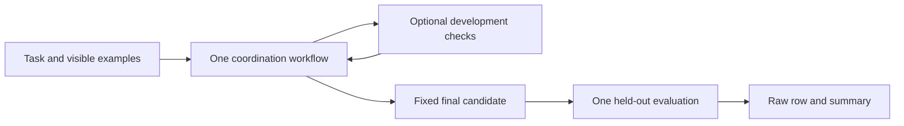

# Multiagent LLM coordination benchmark

This project compares six coordination workflows on the same nine Python programming tasks. It records correctness, model calls, token usage when supplied, generation and sandbox time, and total elapsed time. The task set is small; results are exploratory and cannot establish statistical significance or general rankings.

## Workflows

| CLI key | Implemented workflow |
|---|---|
| `single_agent` | Developer produces a solution. |
| `chain` | Analyst → Developer → Tester → Reviewer. |
| `centralized` | Manager → Analyst → Developer → Tester → Reviewer → Manager. |
| `feedback_graph` | Developer iterates using development-test feedback, followed by review. |
| `fully_connected` | Staged Analyst → Developer → Tester → Reviewer → Developer context sharing; not all-to-all messaging. |
| `parallel_consensus` | Three candidates are generated and tested **sequentially**. The shortest development-passing candidate wins, with generation order breaking ties; if none passes, the first is chosen. A reviewer may revise the chosen candidate. The key is retained for compatibility; this is not concurrent execution. |



## Evaluation protocol v2

Each task has visible examples in prompts, a separate development test for feedback or selection, and final evaluation assertions. The latter are run only after the final candidate is fixed and are never fed back to the model. Invalid code is rejected statically; when generation or infrastructure fails, a final evaluation may not be possible. Tests are public in the repository, so this is a procedural holdout, not a secret benchmark or a guarantee against training-data contamination.

The nine tasks cover email validation, CSV parsing, interval merging, shopping-cart totals, word frequencies, dependency cycles, log analysis, grouping and build ordering. Tests provide limited coverage and development checks are deliberately small. The existing `results/` CSV files and tracked generated solutions are **legacy v1**: earlier workflows used the same hidden tests for selection and final scoring. Their numbers are not directly comparable with v2. No real v2 model results are included here. Mock output uses hard-coded fixtures and is only a plumbing check, not a measure of LLM quality.

## Metrics and limitations

Each invocation creates `runs/<experiment_id>/` with `manifest.json`, `raw_results.csv`, `summary_results.csv` and `generated_solutions/`. Each completed task's row is flushed and synced to disk immediately; the summary is regenerated through an atomic file replacement. An interruption during a task can still lose that unfinished task, and an abrupt interruption while writing a row may leave a partial final CSV row. Old runs are never overwritten; generated code and runs are Git-ignored. The manifest records the protocol, selected tasks, repeats, model, sandbox limits, Python and provider versions, task/prompt hashes, Git commit and tracked-file dirty flag. Seed control is unavailable in this client; provider defaults and evolving model behavior prevent exact reproduction. A dirty flag does not capture untracked files or all dependency versions.

Raw rows contain status, model calls including failed calls observable by the client, token counts only when provider usage is complete, generation time, test time, wall time, test counts and relative candidate paths. No monetary cost is inferred. The summary is computed from raw rows: success is `passed / (passed + failed_tests + invalid_code + candidate_timeout)`; infrastructure and generation/provider failures are excluded and separately counted. Startup failure or timeout is an infrastructure error. A timeout after the container reports readiness is `candidate_timeout` and counts as a failure, although a Docker failure after readiness is not always distinguishable from a stuck candidate. The repeat standard deviation uses available per-repeat success rates. Raw mock calls are fixture calls, not API calls.

Development-test failures may return the exception type and the failing development assertion, capped in size, for feedback. Final evaluation uses no such diagnostic and its outcome never enters another model prompt. Before creating a model client for a benchmark run, a sandbox preflight verifies that the pinned image can start and execute a harmless check; no paid model calls occur when it fails.

## Setup and reproduction

Requires Python 3.10+ and a running Docker daemon. Explicitly install the pinned image once; runs never pull it automatically. The following commands execute generated code **only inside Docker**.

PowerShell, from the repository root:

```powershell
py -m venv .venv
.\.venv\Scripts\python -m pip install -r multiagent_llm_experiment\requirements.txt
docker pull python:3.12.8-alpine3.20@sha256:3b1df87fc50e7d47762aeb48673736079aa22e7c98c8851f5453dd49fc03ad1b
cd multiagent_llm_experiment
..\.venv\Scripts\python -m unittest -v test_protocol test_recording test_sandbox_security
$env:RUN_DOCKER_TESTS='1'
..\.venv\Scripts\python -m unittest -v test_sandbox_integration test_task_quality
..\.venv\Scripts\python main.py --mock --architectures single_agent chain --repeats 2
```

Linux/macOS, from the repository root:

```sh
python3 -m venv .venv
.venv/bin/python -m pip install -r multiagent_llm_experiment/requirements.txt
docker pull python:3.12.8-alpine3.20@sha256:3b1df87fc50e7d47762aeb48673736079aa22e7c98c8851f5453dd49fc03ad1b
cd multiagent_llm_experiment
../.venv/bin/python -m unittest -v test_protocol test_recording test_sandbox_security
RUN_DOCKER_TESTS=1 ../.venv/bin/python -m unittest -v test_sandbox_integration test_task_quality
../.venv/bin/python main.py --mock --architectures single_agent chain --repeats 2
```

For a real GigaChat run, copy `multiagent_llm_experiment/.env.example` to `.env`, configure the credential and omit `--mock`. TLS verification is on by default. A missing credential fails explicitly. Review provider pricing before making paid calls. If the provider requires a custom CA, configure an appropriate trusted certificate; disabling verification is a development-only override.

Recreate a summary and SVG chart from a run (choose new output paths; files are not overwritten):

```sh
python analyze_results.py runs/EXPERIMENT_ID/raw_results.csv --summary summary-copy.csv --plot success.svg
```

## Security and organization

`sandbox_runner.py` starts two isolated non-root Docker containers: one runs the candidate, the other runs trusted tests. The host relays bounded JSON function calls and values; it never executes candidate code. The candidate receives test inputs but not the evaluator's test source or verdict channel. Each container has no network, a read-only root filesystem, dropped capabilities and resource limits. The RPC supports the basic Python values used by the nine tasks, including shared references and ordinary list/dict mutations; it does not support arbitrary Python objects or all Python identity and aliasing semantics. Public tests can still be memorized, and Docker is not a perfect security boundary: container or kernel escapes remain possible. Avoid running untrusted workloads on sensitive hosts. Docker or image unavailability fails closed.

Project code and tests are in `multiagent_llm_experiment/`; `.github/workflows/ci.yml` defines offline and container checks. Tracked historical artifacts are retained. The earlier publication is related prior work, not a specification for this implementation.
