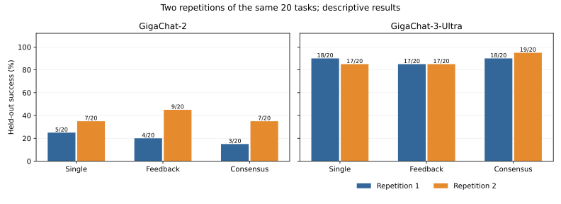
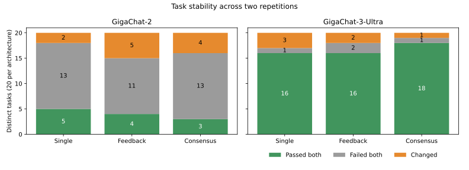
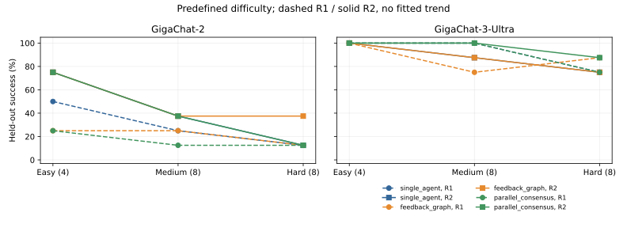

# Benchmark v3: two balanced main repetitions

## Research question and hypotheses

Does multi-agent coordination help code generation as task difficulty increases, and does stronger model capability reduce that benefit? H1 predicts increasing coordination advantage with difficulty. H2 predicts a smaller advantage for Ultra than Lite. Neither is assumed true. This is a descriptive study of 20 predefined tasks, reused across conditions and repetitions; it is not a causal experiment on a random task population.

## Dataset, environment and evidence lineage

First complete main: `e44be8272a9a4592888eee2d63e19667`. Second independently executed main: `adbb87a0aa394be6a8319624686f12fd`. Each contains 120 new evaluations: 20 tasks x 2 models x 3 architectures. No first-run observation substitutes for a second-run observation. Repetition indices are 1 and 2. There are 240 main evaluations of the same **20 distinct tasks**, not 240 independent tasks.

R1 UTC: 2026-11-11T17:03:36.455568+00:00 to 2026-11-11T17:22:37.566344+00:00. R2 UTC: 2026-11-11T17:45:42.590111+00:00 to 2026-11-11T18:04:07.717305+00:00. Client timezone: Asia/Barnaul.

Benchmark v2 used nine tasks and six architectures; its measured full runs were Lite 26/54 and Ultra 51/54. It remains archived unchanged with original data and source. Older publication-era files are separately labelled historical_unverified; missing records are not reconstructed. V3 has 4 easy, 8 medium and 8 hard preregistered tasks, each with visible examples, independent development and held-out tests, trusted references, negative/edge cases and a difficulty rationale. Before API calls, 70 development cases, 121 held-out cases and 1,285 oracle/property checks passed, together with Docker fixture validation.

Difficulty is an a-priori judgement: easy means simple scanning/indexing, medium combines boundary/state rules or a standard graph/data-structure algorithm, hard includes recursive parsing, dynamic programming, global graph problems and transactional/patch semantics. These labels are not human-calibrated; size limits do not enforce a particular asymptotic complexity. Task definitions and expected outputs were not tuned after model outcomes.

The adapter explicitly uses the frozen v2 worktree at `multiagent_llm_experiment`, base commit `5e469e9cfcb185ae9650136dc5c539a9dad50256`, with its pre-existing dirty files. All 19 Python hashes match the saved Lite snapshot; both main manifests have identical v2 source hashes. Frozen v3 preparation hashes remain checked. Exact per-run runner/source snapshots, task hashes and manifests accompany the datasets. Only repetition metadata, budgeting and execution control changed to enable repetition 2; tasks, prompts, coordinators, development tests and held-out tests did not change. All six architectures remain in the codebase.

Both models used `https://api.giga.chat/v1/`, max_tokens=4096, max feedback iterations=3, one non-streaming choice and other provider generation defaults. Host Python 3.14.4, gigachat SDK 0.2.1, Windows; unchanged pinned Docker Python 3.12.8 Alpine image. No seed control is available. These are fresh API executions, but stochastic independence cannot be verified. Serial model/architecture/task order was preserved, not randomized; temporal and provider/cache effects may confound comparisons. Automatic SDK retries were disabled. Development feedback and final held-out scoring remain separate.

The calibration pilot is cost calibration only. The earlier aborted main `d682d606a0ee4fc69d0e6b3cee054efb` remains separately preserved with seven completed observations and one unknown-billing request. Its outcomes are excluded from both complete main datasets. The user explicitly approved a full restart for main 1 and then a second balanced repetition. All historical costs and the full 69,632-token unknown-request reservation remain in the shared ledger. No third repetition was executed.

Provider-returned model identifiers: {"1": [["GigaChat-2", "GigaChat-2:2.0.30.01"], ["GigaChat-3-Ultra", "GigaChat-3-Ultra:32.9.16.9"]], "2": [["GigaChat-2", "GigaChat-2:2.0.30.01"], ["GigaChat-3-Ultra", "GigaChat-3-Ultra:32.9.16.9"]]}.

The provider-returned versions were identical across repetitions.

## Success and resource use in each repetition

| Model | Architecture | R1 passed/20 | R2 passed/20 | R1 tokens incl. cache | R2 tokens incl. cache | R1 calls | R2 calls | R1 mean seconds | R2 mean seconds |
| --- | --- | --- | --- | --- | --- | --- | --- | --- | --- |
| GigaChat-2 | single_agent | 5/20 (25.0%) | 7/20 (35.0%) | 9290 | 9251 | 20 | 20 | 3.10 | 2.91 |
| GigaChat-2 | feedback_graph | 4/20 (20.0%) | 9/20 (45.0%) | 69999 | 81778 | 124 | 114 | 12.78 | 13.10 |
| GigaChat-2 | parallel_consensus | 3/20 (15.0%) | 7/20 (35.0%) | 65192 | 65847 | 120 | 120 | 15.35 | 13.20 |
| GigaChat-3-Ultra | single_agent | 18/20 (90.0%) | 17/20 (85.0%) | 8910 | 9005 | 20 | 20 | 2.80 | 2.76 |
| GigaChat-3-Ultra | feedback_graph | 17/20 (85.0%) | 17/20 (85.0%) | 45869 | 46799 | 85 | 82 | 8.24 | 8.24 |
| GigaChat-3-Ultra | parallel_consensus | 18/20 (90.0%) | 19/20 (95.0%) | 67643 | 68558 | 120 | 120 | 13.72 | 13.81 |

Overall by model and repetition:

| Repeat | Model | Passed/60 | Success | Input usage | Cached input | Output | Provider total | Combined incl. cache | Calls | Evaluation seconds |
| --- | --- | --- | --- | --- | --- | --- | --- | --- | --- | --- |
| 1 | GigaChat-2 | 12/60 | 20.0% | 89374 | 16396 | 38711 | 128085 | 144481 | 264 | 624.61 |
| 1 | GigaChat-3-Ultra | 53/60 | 88.3% | 82728 | 4032 | 35662 | 118390 | 122422 | 225 | 495.24 |
| 2 | GigaChat-2 | 23/60 | 38.3% | 87791 | 25526 | 43559 | 131350 | 156876 | 254 | 584.21 |
| 2 | GigaChat-3-Ultra | 53/60 | 88.3% | 83185 | 4608 | 36569 | 119754 | 124362 | 222 | 496.12 |

Across the two complete main runs: 343,078 input usage + 50,562 cached input + 154,501 output = **548,141 combined tokens**, 965 LLM calls, 2200.18 summed evaluation seconds. Provider total excluding cached input: 497,579. All failed attempts are included in resource totals.

Summed client-side API latency across both complete repetitions is 1231.83 seconds. Mean summed API latency per evaluation is 5.13 seconds. Evaluation time additionally includes sandbox, coordination and persistence. Complete per-evaluation latency and mean API seconds are in the CSV tables. Privacy-minimized request metadata and latency are public; original response JSON remains in the private archive. Requested and returned identifiers are both recorded; model versions are not independently verified beyond the provider response.

Failures across complete main runs: {'failed_tests': 96, 'candidate_timeout': 2, 'invalid_code': 1}. Finish reasons: {'stop': 964, 'length': 1}. Candidate timeouts and invalid code are not infrastructure successes. Missing usage is never zero-filled; the older unknown-billing request is excluded from measured main totals and remains reserved in budget accounting.

## Task stability across repetitions

| Model | Architecture | Stable success | Stable failure | Improved R2 | Regressed R2 |
| --- | --- | --- | --- | --- | --- |
| GigaChat-2 | single_agent | 5 | 13 | 2 | 0 |
| GigaChat-2 | feedback_graph | 4 | 11 | 5 | 0 |
| GigaChat-2 | parallel_consensus | 3 | 13 | 4 | 0 |
| GigaChat-3-Ultra | single_agent | 16 | 1 | 1 | 2 |
| GigaChat-3-Ultra | feedback_graph | 16 | 2 | 1 | 1 |
| GigaChat-3-Ultra | parallel_consensus | 18 | 1 | 1 | 0 |

Stable failure means neither repetition passed; failure categories may differ. Every task's name, difficulty, two statuses and stability label are in `task-stability.csv`, including all stable and changing outcomes. The observations are paired on identical tasks.

### Identified stable and changing tasks

IDs map to the frozen task inventory; full task names and exact statuses are retained in task-stability.csv.

| Model | Architecture | Stable passed IDs | Stable failed IDs | Improved IDs | Regressed IDs |
| --- | --- | --- | --- | --- | --- |
| GigaChat-2 | single_agent | v3_01, v3_04, v3_07, v3_12, v3_20 | v3_02, v3_05, v3_06, v3_08, v3_09, v3_11, v3_13, v3_14, v3_15, v3_16, v3_17, v3_18, v3_19 | v3_03, v3_10 | none |
| GigaChat-2 | feedback_graph | v3_01, v3_07, v3_12, v3_20 | v3_02, v3_06, v3_08, v3_09, v3_10, v3_11, v3_13, v3_14, v3_17, v3_18, v3_19 | v3_03, v3_04, v3_05, v3_15, v3_16 | none |
| GigaChat-2 | parallel_consensus | v3_01, v3_12, v3_20 | v3_02, v3_06, v3_07, v3_08, v3_09, v3_11, v3_13, v3_14, v3_15, v3_16, v3_17, v3_18, v3_19 | v3_03, v3_04, v3_05, v3_10 | none |
| GigaChat-3-Ultra | single_agent | v3_01, v3_02, v3_03, v3_04, v3_05, v3_06, v3_07, v3_09, v3_10, v3_11, v3_12, v3_14, v3_15, v3_16, v3_19, v3_20 | v3_18 | v3_13 | v3_08, v3_17 |
| GigaChat-3-Ultra | feedback_graph | v3_01, v3_02, v3_03, v3_04, v3_05, v3_06, v3_07, v3_09, v3_10, v3_12, v3_13, v3_14, v3_15, v3_16, v3_19, v3_20 | v3_11, v3_18 | v3_08 | v3_17 |
| GigaChat-3-Ultra | parallel_consensus | v3_01, v3_02, v3_03, v3_04, v3_05, v3_06, v3_07, v3_08, v3_09, v3_10, v3_11, v3_12, v3_14, v3_15, v3_16, v3_17, v3_19, v3_20 | v3_18 | v3_13 | none |

## Paired coordination comparisons

For each task, compare a coordinated architecture with Single Agent in the same model and repetition. 'Coord only' and 'Single only' are discordant pairs; their difference is the observed change in passed-task count. No unpaired test or significance claim is made.

| Repeat | Model | Architecture | Both pass | Coord only | Single only | Both fail | Net passed-task difference |
| --- | --- | --- | --- | --- | --- | --- | --- |
| 1 | GigaChat-2 | feedback_graph | 4 | 0 | 1 | 15 | -1 |
| 1 | GigaChat-2 | parallel_consensus | 3 | 0 | 2 | 15 | -2 |
| 1 | GigaChat-3-Ultra | feedback_graph | 16 | 1 | 2 | 1 | -1 |
| 1 | GigaChat-3-Ultra | parallel_consensus | 18 | 0 | 0 | 2 | 0 |
| 2 | GigaChat-2 | feedback_graph | 6 | 3 | 1 | 10 | 2 |
| 2 | GigaChat-2 | parallel_consensus | 6 | 1 | 1 | 12 | 0 |
| 2 | GigaChat-3-Ultra | feedback_graph | 16 | 1 | 1 | 2 | 0 |
| 2 | GigaChat-3-Ultra | parallel_consensus | 17 | 2 | 0 | 1 | 2 |

## Predefined task difficulty

| Repeat | Model | Architecture | Easy /4 | Medium /8 | Hard /8 |
| --- | --- | --- | --- | --- | --- |
| 1 | GigaChat-2 | single_agent | 2 | 2 | 1 |
| 1 | GigaChat-2 | feedback_graph | 1 | 2 | 1 |
| 1 | GigaChat-2 | parallel_consensus | 1 | 1 | 1 |
| 1 | GigaChat-3-Ultra | single_agent | 4 | 8 | 6 |
| 1 | GigaChat-3-Ultra | feedback_graph | 4 | 6 | 7 |
| 1 | GigaChat-3-Ultra | parallel_consensus | 4 | 8 | 6 |
| 2 | GigaChat-2 | single_agent | 3 | 3 | 1 |
| 2 | GigaChat-2 | feedback_graph | 3 | 3 | 3 |
| 2 | GigaChat-2 | parallel_consensus | 3 | 3 | 1 |
| 2 | GigaChat-3-Ultra | single_agent | 4 | 7 | 6 |
| 2 | GigaChat-3-Ultra | feedback_graph | 4 | 7 | 6 |
| 2 | GigaChat-3-Ultra | parallel_consensus | 4 | 8 | 7 |

The lines connect predefined categories for readability and are not fitted trends. Difficulty denominators are only 4/8/8 tasks; task content and labels cannot be separated as causal factors.

## Descriptive pooled efficiency and repetition variability

The denominator below is 40 task-repetition observations per model/architecture, representing the same 20 tasks twice. It must not be interpreted as 40 independent tasks. Tokens per pass include unsuccessful attempts. Repeat-rate sample SD uses only two rates and is unstable; it is not a confidence interval.

| Model | Architecture | Passed /40 | Tokens/pass | Ratio to Single | Repeat rate range | Sample SD (pp) |
| --- | --- | --- | --- | --- | --- | --- |
| GigaChat-2 | single_agent | 12/40 | 1545.1 | 1.00 | 25.0%-35.0% | 7.07 |
| GigaChat-2 | feedback_graph | 13/40 | 11675.2 | 7.56 | 20.0%-45.0% | 17.68 |
| GigaChat-2 | parallel_consensus | 10/40 | 13103.9 | 8.48 | 15.0%-35.0% | 14.14 |
| GigaChat-3-Ultra | single_agent | 35/40 | 511.9 | 1.00 | 85.0%-90.0% | 3.54 |
| GigaChat-3-Ultra | feedback_graph | 34/40 | 2725.5 | 5.32 | 85.0%-85.0% | 0.00 |
| GigaChat-3-Ultra | parallel_consensus | 37/40 | 3681.1 | 7.19 | 90.0%-95.0% | 3.54 |

## Hypotheses and limitations

Observed coordination differences for both repetitions:

- R1, GigaChat-2: feedback_graph: -5.0 pp; parallel_consensus: -10.0 pp.
- R1, GigaChat-3-Ultra: feedback_graph: -5.0 pp; parallel_consensus: +0.0 pp.
- R2, GigaChat-2: feedback_graph: +10.0 pp; parallel_consensus: +0.0 pp.
- R2, GigaChat-3-Ultra: feedback_graph: +0.0 pp; parallel_consensus: +10.0 pp.

These paired contrasts and the difficulty table allow assessment of the direction observed in this suite. They do not justify a universal claim that stronger models benefit less from coordination. A benefit confined to one hard task, a ceiling effect on easy tasks or differences that reverse between repetitions require replication. No statistical significance, population-level or causal claim is made. Detailed changing task IDs permit inspection without post-hoc test tuning.

Only two repetitions and 20 authored tasks were observed, with dependent repeated task measurements. There is no seed control, randomized execution order or assurance of stochastic independence. Provider defaults/versions and input caching may drift. Difficulty is subjective, reference validation is dynamic rather than formal proof, and task coverage is narrow. The known adversarial sandbox RPC integrity limitation remains; Docker test passage does not establish security against intentionally malicious generated code. Future work should use independently reviewed tasks, more preregistered repetitions, counterbalanced order and stronger isolation.

### Interpretation of the two measured repetitions

Lite improves from 12/60 to 23/60, while Ultra has 53/60 in both repetitions. Equal Ultra totals hide task-level changes: three task-architecture cells improve and three regress. Across both models, 17 of the 120 matched task-architecture pairs change pass/fail outcome; the other 103 are stable. These are condition-level pairs sharing the same 20 tasks, not 120 independent tasks.

Feedback changes the passed-task count relative to Single Agent by -1 then +2 for Lite, and -1 then 0 for Ultra. Consensus changes it by -2 then 0 for Lite, and 0 then +2 for Ultra. Thus the second repetition shows some coordination gains, but the direction is architecture- and repetition-specific. The feedback contrast in R2 is compatible with a smaller Ultra benefit; the consensus contrasts do not support that generalization. Neither H1 nor H2 is established by these two repetitions.

On hard tasks, the Ultra feedback advantage seen in R1 (7/8 versus 6/8) does not repeat in R2 (6/8 versus 6/8). Lite feedback has 3/8 versus 1/8 in R2, compared with 1/8 versus 1/8 in R1. Ultra consensus reaches 7/8 hard tasks in R2 versus 6/8 for Single Agent. These narrow gains motivate replication, not causal claims about difficulty. Coordination remains substantially more token-intensive per passed solution in the pooled descriptive table.

One R2 response reached max_tokens=4096: Lite feedback on v3_13 evaluate_expression. It is preserved with finish_reason=length; the final evaluation status is candidate_timeout. The existing three-iteration feedback policy ran normally, with no transport retry or extra task evaluation. Co-occurrence alone does not establish that truncation caused the timeout.

## Budget, approval and preserved artifacts

The conservative preflight used existing known usage 313,152 + unknown-request reserve 69,632 + ceil(266,903 x 1.5) = 400,355 + an additional request reserve 69,632 = 852,771 tokens. The user explicitly approved increasing the target from 850,000 to 853,000 before repetition 2. The 1,000,000 hard ceiling and all prior costs/reservations remained unchanged. The approval is durable in the ledger and second manifest.

Known usage across pilot, abandoned attempt and both complete mains: **594,390 tokens including cache**. Unknown-billing requests: 1; full retained reserve: 69,632. Known plus reservations: **664,022**. Remaining after reservations: 188,978 to approved target 853,000, and 335,978 to hard ceiling 1,000,000. The exact aggregate actual consumption remains unknown until the older unresolved request is reconciled; the reserve is an allowance, not measured usage. No third repetition was run.

- First complete main: `research/benchmark-v3/runs/e44be8272a9a4592888eee2d63e19667`
- Second complete main: `research/benchmark-v3/runs/adbb87a0aa394be6a8319624686f12fd`
- Paired tables and SVG figures: `research/benchmark-v3/runs/adbb87a0aa394be6a8319624686f12fd/analysis`
- Public request audit: `research/benchmark-v3/audit/requests.csv`
- Offline analysis script: `tools/reproduce.py`
- First single-run report preserved: `research/benchmark-v3/runs/e44be8272a9a4592888eee2d63e19667/analysis/research-report-first-repetition.md`
- Reproduce offline: `python tools/reproduce.py`

Original artifacts remain unchanged in the private archive. Public raw/summary CSV and generated solutions are byte-identical; public metadata/source-snapshot paths are redacted as documented. The comparison reads the privacy-minimized audit CSV exported from the frozen SQLite snapshot. No API calls are performed by this script.

## Publication provenance and privacy

Public raw and summary CSV files are byte-identical to the measured originals. Personal filesystem metadata in manifests, source snapshots and documentation is redacted in explicitly derived publication copies; original hashes and public hashes are recorded in provenance/artifact-lineage.json. The exact originals, including private SQLite responses, remain in a documented local archive identified by provenance/local-archive.json. No raw response bodies, credentials or session headers are public. The portable runtime is a publication adaptation, distinct from the recorded measurement source snapshots.
